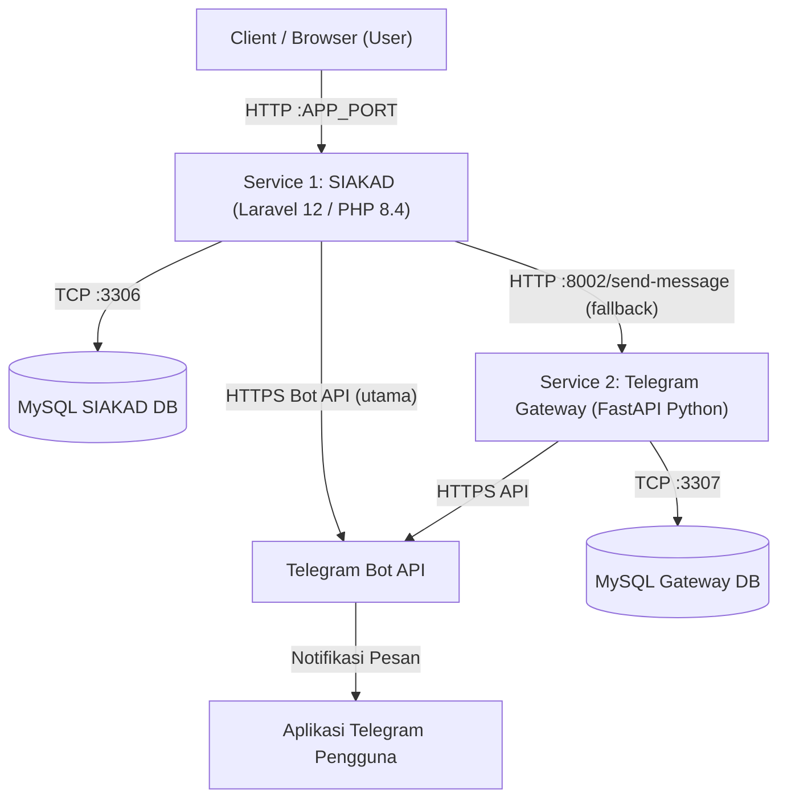

# 📚 Panduan Deployment & Menjalankan Multi-Service Docker
## Tugas Besar Cloud Computing

**Anggota Kelompok:**
1. M. Syihabul Alam (240602008)
2. M. Nur Amin (260602001)
3. Dimas Candra (240602001)
4. M. Askhabur Rida' (240602007)

---

## 1. Arsitektur Sistem

Sistem ini terdiri dari dua layanan (*microservices*) independen yang berkomunikasi menggunakan REST API dan berjalan di dalam container Docker:



### Rincian Service & Port Mapping

| Service | Komponen | Port Host | URL Akses | Fungsi |
|---|---|---|---|---|
| **Service 1 (SIAKAD)** | Laravel Web App | `APP_PORT` (default `8080`; mesin ini `8081`) | `APP_URL` (mesin ini: `http://localhost:8081`) | Portal Sistem Informasi Akademik |
| **Service 1 (SIAKAD)** | MySQL Database | `FORWARD_DB_PORT` (default `3306`; mesin ini `3308`) | `localhost:FORWARD_DB_PORT` | Database utama SIAKAD |
| **Service 1 (SIAKAD)** | Mailpit | `8025` | `http://localhost:8025` | Mail testing dashboard |
| **Service 2 (Gateway)** | FastAPI Backend | `8002` | `http://localhost:8002/docs` | REST API Telegram Gateway & Swagger Docs |
| **Service 2 (Gateway)** | Nginx Proxy | `80` | `http://localhost` | Reverse proxy Service 2 |
| **Service 2 (Gateway)** | MySQL Database | `3307` | `localhost:3307` | Database logs gateway |

---

## 2. Prasyarat Sistem (Prerequisites)

Sebelum menjalankan aplikasi, pastikan di komputer telah terpasang:
1. **Docker Desktop** (untuk Windows/macOS) dengan WSL 2 aktif, ATAU **Docker Engine & Docker Compose v2** (untuk Linux).
   - Pastikan Docker daemon sudah berstatus **Running**.
2. **Git** (untuk meng-clone repositori).
3. **Koneksi Internet** (untuk download image Docker pertama kali dan koneksi bot Telegram).

> 💡 **Catatan:** Penguji/Dosen **TIDAK PERLU** meng-install PHP, Composer, Node.js, atau MySQL di komputernya. Semua dependensi berjalan 100% di dalam Docker.

---

## 3. Langkah Instalasi dari GitHub (Fresh Clone)

Buka terminal (**PowerShell** di Windows atau **Bash** di Linux/macOS):

### Langkah 1: Clone Repositori
```bash
git clone <URL_REPOSITORY_GITHUB_ANDA>
cd Tugas_CloudComputing
```

---

### Langkah 2: Menjalankan Service 2 (Telegram Gateway)

1. Masuk ke folder Service 2:
   ```bash
   cd "telegramgateway(service2)"
   ```
2. Buat file `.env` dari template:
   ```bash
   # Windows PowerShell:
   Copy-Item .env.example .env

   # Linux / macOS:
   cp .env.example .env
   ```
   Buka file `.env` tersebut dan isi `TELEGRAM_BOT_TOKEN` dengan token bot dari BotFather. Jangan menyimpan token bot di README, `.env.example`, atau Git. Jika token pernah masuk ke Git, cabut dan buat token baru melalui BotFather.

3. Jalankan container Service 2:
   ```bash
   docker compose up -d --build
   ```
   > **Verifikasi Service 2:** Buka browser di [http://localhost:8002/docs](http://localhost:8002/docs) (Swagger UI FastAPI aktif).

---

### Langkah 3: Menjalankan Service 1 (SIAKAD)

1. Pindah ke folder Service 1:
   ```bash
   cd "../siakad(service1)"
   ```
2. Buat file `.env` dari template:
   ```bash
   # Windows PowerShell:
   Copy-Item .env.example .env

   # Linux / macOS:
   cp .env.example .env
   ```
   File `.env.example` mengatur `TELEGRAM_GATEWAY_URL=http://host.docker.internal:8002`, database MySQL Docker, dan variabel Telegram. Isi `TELEGRAM_BOT_TOKEN` pada `.env` SIAKAD dengan token yang sama seperti di `.env` Gateway agar queue worker mengirim langsung ke Bot API. Isi `TELEGRAM_NOTIFICATION_CHAT_ID` dengan Chat ID grup tujuan.

3. **Install Dependensi Composer via Docker** *(Karena folder vendor tidak di-commit ke Git)*:
   
   **Jika menggunakan Windows PowerShell:**
   ```powershell
   docker run --rm -v ${PWD}:/var/www/html -w /var/www/html laravelsail/php84-composer:latest composer install --ignore-platform-reqs
   ```

   **Jika menggunakan Linux / macOS:**
   ```bash
   docker run --rm -u "$(id -u):$(id -g)" -v "$(pwd):/var/www/html" -w /var/www/html laravelsail/php84-composer:latest composer install --ignore-platform-reqs
   ```

4. Jalankan database dan aplikasi web SIAKAD:
   ```bash
   docker compose up -d mysql laravel.test
   ```

---

### Langkah 4: Inisialisasi Database SIAKAD (Key, Migrasi & Seeder)

Langkah ini hanya untuk instalasi baru. Jika database sudah berisi data, jangan menjalankan `key:generate` atau `migrate --seed` ulang; cukup pastikan migrasi sudah diterapkan.

Setelah container SIAKAD aktif pada instalasi baru, jalankan:

```bash
docker compose exec laravel.test php artisan key:generate
docker compose exec laravel.test php artisan migrate --seed
```

Perintah ini akan secara otomatis:
- Men-generate APP_KEY enkripsi Laravel.
- Menjalankan seluruh migrasi database aplikasi, termasuk tabel antrean.
- Mengisi data master kurikulum, fakultas, prodi, dan 4 akun login demo.

Setelah migrasi selesai, hidupkan worker antrean:

```bash
docker compose up -d laravel.queue
```

---

## 4. Akun Default untuk Pengujian / Demo Dosen

Setelah proses seed selesai, login ke alamat `APP_URL`. Pada clone baru alamat default-nya `http://localhost:8080`; konfigurasi lokal yang dijalankan pada mesin ini menggunakan **[http://localhost:8081](http://localhost:8081)**.

| Role Pengguna | Email | Password | Hak Akses |
|---|---|---|---|
| **Superadmin** | `superadmin@siakad.test` | `password` | Kelola master data, pengguna, dosen, dan sistem |
| **Admin Fakultas** | `admin.ftik@siakad.test` | `password` | Kelola data fakultas dan program studi |
| **Dosen** | `dosen@siakad.test` | `password` | Input nilai, presensi, bimbingan KRS & skripsi |
| **Mahasiswa** | `mahasiswa@siakad.test` | `password` | Pengisian KRS, KHS, transkrip, & AI Advisor |

---

## 5. Cara Menguji Notifikasi Telegram

1. **Aktivasi Bot Telegram:**
   - Buka bot yang tokennya sudah diatur di `.env`, lalu tekan **Start**.
   - Tambahkan bot ke grup yang Anda pilih. Pastikan semua anggota grup berwenang melihat informasi login dan akademik yang dikirim.
   - Isi `TELEGRAM_NOTIFICATION_CHAT_ID` pada `.env` SIAKAD dengan Chat ID grup. Nilai ini sudah diatur pada konfigurasi lokal mesin ini; jangan memasukkannya ke README atau Git.
   - Pastikan `TELEGRAM_BOT_TOKEN` pada `.env` SIAKAD sama dengan token bot Gateway. Setelah mengubah konfigurasi, dari folder `siakad(service1)` jalankan `docker compose restart laravel.test laravel.queue`.
2. **Pastikan layanan siap:**
   - SIAKAD: buka alamat `APP_URL`; pada mesin ini [http://localhost:8081](http://localhost:8081).
   - Gateway (fallback): jika token SIAKAD kosong, pastikan [http://localhost:8002/health](http://localhost:8002/health) merespons `{"status":"ok"}`.
   - Di PowerShell, dari folder `telegramgateway(service2)`, jalankan `docker compose ps`; dari folder `siakad(service1)`, jalankan `docker compose ps`. Pastikan container `laravel.queue` berjalan.
3. **Uji pengiriman nyata dari aplikasi:**
   - **Login:** logout, lalu login kembali. Grup seharusnya menerima notifikasi login.
   - **KRS:** ajukan KRS sebagai mahasiswa, lalu minta dosen PA/admin menyetujui atau menolak pengajuan. Grup seharusnya menerima status KRS dengan nama mahasiswa.
   - **Perubahan jadwal:** sebagai admin, ubah hari, jam, atau ruangan kelas yang memiliki mahasiswa terdaftar. Grup seharusnya menerima notifikasi untuk mahasiswa yang mengambil kelas tersebut.
   - **Nilai:** sebagai dosen, simpan/perbarui nilai mahasiswa pada menu penilaian. Grup seharusnya menerima nilai yang diperbarui beserta nama penerima.
4. **Periksa error jika pesan tidak tiba:**
   - Dari folder `siakad(service1)`, lihat antrean gagal: `docker compose exec laravel.test php artisan queue:failed`.
   - Lihat log worker: `docker logs --tail 100 lms-queue-worker`.
   - Lihat log Gateway: `docker logs --tail 100 telegramgatewayservice2-app-1`.
   - Pastikan bot sudah berada di grup, Chat ID grup benar, `QUEUE_CONNECTION=database`, dan token SIAKAD benar. Jika token SIAKAD kosong, pastikan Gateway aktif.

> **Penting untuk PowerShell di Windows:** jangan jalankan `php artisan queue:work` langsung di komputer host. `.env` mengatur `DB_HOST=mysql`, nama service yang hanya bisa ditemukan dari jaringan Docker. Jangan mengubahnya menjadi `localhost`, karena aplikasi di dalam Docker juga memakai `.env` yang sama. Worker `laravel.queue` sudah berjalan di container.

Untuk melihat proses worker:

```powershell
Set-Location "siakad(service1)"
docker compose ps
docker logs -f lms-queue-worker
```

Jika perlu menjalankan worker di foreground untuk debugging, hentikan worker latar dahulu agar tidak ada dua worker:

```powershell
Set-Location "siakad(service1)"
docker compose stop laravel.queue
docker compose exec laravel.test php artisan queue:work database --verbose
```

Setelah menghentikan perintah foreground dengan `Ctrl+C`, hidupkan kembali worker latar:

```powershell
docker compose start laravel.queue
```

Tes otomatis yang hanya memverifikasi job masuk antrean (tidak mengirim pesan Telegram sungguhan):

```powershell
Set-Location "siakad(service1)"
docker compose exec laravel.test php artisan test tests/Unit/TelegramNotificationDispatchTest.php
```

Notifikasi dikirim di latar belakang oleh queue worker. Waktu tiba tetap bergantung pada koneksi internet dan layanan Telegram; tidak dijamin tanpa jeda.

---

## 6. Perintah Pemeliharaan (Maintenance Commands)

| Kebutuhan | Perintah Terminal |
|---|---|
| **Melihat status semua container** | `docker ps` |
| **Melihat log real-time SIAKAD** | `docker logs -f siakadservice1-laravel.test-1` |
| **Melihat log real-time Telegram Gateway** | `docker logs -f telegramgatewayservice2-app-1` |
| **Restart kedua service** | `docker restart siakadservice1-laravel.test-1 telegramgatewayservice2-app-1` |
| **Menghentikan Service 1** | `cd "siakad(service1)" && docker compose down` |
| **Menghentikan Service 2** | `cd "telegramgateway(service2)" && docker compose down` |
| **Buka phpMyAdmin (Database GUI)** | `docker run -d --name siakad-pma --network siakadservice1_sail -p 8082:80 -e PMA_HOST=mysql phpmyadmin/phpmyadmin` (akses di `http://localhost:8082`; pastikan port kosong) |

### Bersihkan file sementara yang bisa dibuat ulang

Cache tampilan Blade aman dibersihkan; Laravel akan membuatnya kembali saat dibutuhkan:

```powershell
Set-Location "siakad(service1)"
docker compose exec laravel.test php artisan view:clear
```

Jangan menghapus `.env`, `vendor`, database, atau log untuk menghemat ruang tanpa memeriksa isinya: konfigurasi, dependensi, data, dan log tersebut diperlukan untuk menjalankan atau mendiagnosis aplikasi.
