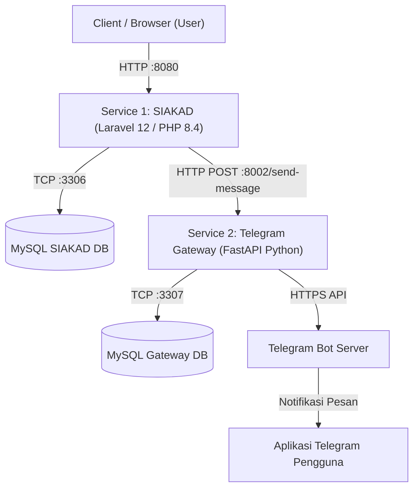

# 📚 Panduan Deployment & Menjalankan Multi-Service Docker
## Tugas Besar Cloud Computing

**Anggota Kelompok:**
1. M. Syihabul Alam (240602008)
2. M. Nur Amin (260602001)
3. Dimas Candra (240602001)
4. M. Askhabur Rida' (240602007)

---

## 1. Arsitektur Sistem

Sistem ini terdiri dari dua layanan (*microservices*) independen yang berkomunikasi menggunakan REST API dan berjalan di dalam container Docker:



### Rincian Service & Port Mapping

| Service | Komponen | Port Host | URL Akses | Fungsi |
|---|---|---|---|---|
| **Service 1 (SIAKAD)** | Laravel Web App | `8080` | `http://localhost:8080` | Portal Sistem Informasi Akademik |
| **Service 1 (SIAKAD)** | MySQL Database | `3306` | `localhost:3306` | Database utama SIAKAD |
| **Service 1 (SIAKAD)** | Mailpit | `8025` | `http://localhost:8025` | Mail testing dashboard |
| **Service 2 (Gateway)** | FastAPI Backend | `8002` | `http://localhost:8002/docs` | REST API Telegram Gateway & Swagger Docs |
| **Service 2 (Gateway)** | Nginx Proxy | `80` | `http://localhost` | Reverse proxy Service 2 |
| **Service 2 (Gateway)** | MySQL Database | `3307` | `localhost:3307` | Database logs gateway |

---

## 2. Prasyarat Sistem (Prerequisites)

Sebelum menjalankan aplikasi, pastikan di komputer telah terpasang:
1. **Docker Desktop** (untuk Windows/macOS) dengan WSL 2 aktif, ATAU **Docker Engine & Docker Compose v2** (untuk Linux).
   - Pastikan Docker daemon sudah berstatus **Running**.
2. **Git** (untuk meng-clone repositori).
3. **Koneksi Internet** (untuk download image Docker pertama kali dan koneksi bot Telegram).

> 💡 **Catatan:** Penguji/Dosen **TIDAK PERLU** meng-install PHP, Composer, Node.js, atau MySQL di komputernya. Semua dependensi berjalan 100% di dalam Docker.

---

## 3. Langkah Instalasi dari GitHub (Fresh Clone)

Buka terminal (**PowerShell** di Windows atau **Bash** di Linux/macOS):

### Langkah 1: Clone Repositori
```bash
git clone <URL_REPOSITORY_GITHUB_ANDA>
cd Tugas_CloudComputing
```

---

### Langkah 2: Menjalankan Service 2 (Telegram Gateway)

1. Masuk ke folder Service 2:
   ```bash
   cd "telegramgateway(service2)"
   ```
2. Buat file `.env` dari template:
   ```bash
   # Windows PowerShell:
   Copy-Item .env.example .env

   # Linux / macOS:
   cp .env.example .env
   ```
   *(File `.env.example` sudah disetup dengan bot token Telegram `@siakadcc_bot` yang siap pakai).*

3. Jalankan container Service 2:
   ```bash
   docker compose up -d --build
   ```
   > **Verifikasi Service 2:** Buka browser di [http://localhost:8002/docs](http://localhost:8002/docs) (Swagger UI FastAPI aktif).

---

### Langkah 3: Menjalankan Service 1 (SIAKAD)

1. Pindah ke folder Service 1:
   ```bash
   cd "../siakad(service1)"
   ```
2. Buat file `.env` dari template:
   ```bash
   # Windows PowerShell:
   Copy-Item .env.example .env

   # Linux / macOS:
   cp .env.example .env
   ```
   *(File `.env.example` sudah disetup otomatis terhubung ke `http://host.docker.internal:8002` dan database MySQL Docker).*

3. **Install Dependensi Composer via Docker** *(Karena folder vendor tidak di-commit ke Git)*:
   
   **Jika menggunakan Windows PowerShell:**
   ```powershell
   docker run --rm -v ${PWD}:/var/www/html -w /var/www/html laravelsail/php84-composer:latest composer install --ignore-platform-reqs
   ```

   **Jika menggunakan Linux / macOS:**
   ```bash
   docker run --rm -u "$(id -u):$(id -g)" -v "$(pwd):/var/www/html" -w /var/www/html laravelsail/php84-composer:latest composer install --ignore-platform-reqs
   ```

4. Jalankan container SIAKAD:
   ```bash
   docker compose up -d
   ```

---

### Langkah 4: Inisialisasi Database SIAKAD (Key, Migrasi & Seeder)

Setelah container SIAKAD aktif, jalankan perintah berikut di terminal:

```bash
docker exec siakadservice1-laravel.test-1 php artisan key:generate
docker exec siakadservice1-laravel.test-1 php artisan migrate --seed
```

Perintah ini akan secara otomatis:
- Men-generate APP_KEY enkripsi Laravel.
- Membuat 39 tabel database akademik di container MySQL.
- Mengisi data master kurikulum, fakultas, prodi, dan 4 akun login demo.

---

## 4. Akun Default untuk Pengujian / Demo Dosen

Setelah proses seed selesai, dosen dapat langsung login ke web SIAKAD di: 👉 **[http://localhost:8080](http://localhost:8080)**

| Role Pengguna | Email | Password | Hak Akses |
|---|---|---|---|
| **Superadmin** | `superadmin@siakad.test` | `password` | Kelola master data, pengguna, dosen, dan sistem |
| **Admin Fakultas** | `admin.ftik@siakad.test` | `password` | Kelola data fakultas dan program studi |
| **Dosen** | `dosen@siakad.test` | `password` | Input nilai, presensi, bimbingan KRS & skripsi |
| **Mahasiswa** | `mahasiswa@siakad.test` | `password` | Pengisian KRS, KHS, transkrip, & AI Advisor |

---

## 5. Cara Mendemonstrasikan Notifikasi Telegram ke Dosen

1. **Aktivasi Bot Telegram:**
   - Dosen membuka Telegram dan mencari bot: **`@siakadcc_bot`** (atau via link: [https://t.me/siakadcc_bot](https://t.me/siakadcc_bot)).
   - Klik tombol **Start** (`/start`).
2. **Dapatkan Chat ID Dosen:**
   - Dosen membuka bot **`@userinfobot`** di Telegram dan klik `/start`.
   - Catat angka **Id** (contoh: `1234567890`).
3. **Simpan Chat ID ke Akun SIAKAD:**
   - Login ke [http://localhost:8080](http://localhost:8080) dengan akun `mahasiswa@siakad.test` (password: `password`).
   - Masuk ke menu **Profil** di pojok kanan atas.
   - Isi kolom **Telegram Chat ID** dengan nomor ID dosen, lalu klik **Simpan**.
4. **Uji Notifikasi:**
   - Klik **Logout** lalu lakukan **Login** kembali.
   - Bot **`@siakadcc_bot`** akan langsung mengirimkan notifikasi login ke akun Telegram dosen.

---

## 6. Perintah Pemeliharaan (Maintenance Commands)

| Kebutuhan | Perintah Terminal |
|---|---|
| **Melihat status semua container** | `docker ps` |
| **Melihat log real-time SIAKAD** | `docker logs -f siakadservice1-laravel.test-1` |
| **Melihat log real-time Telegram Gateway** | `docker logs -f telegramgatewayservice2-app-1` |
| **Restart kedua service** | `docker restart siakadservice1-laravel.test-1 telegramgatewayservice2-app-1` |
| **Menghentikan Service 1** | `cd "siakad(service1)" && docker compose down` |
| **Menghentikan Service 2** | `cd "telegramgateway(service2)" && docker compose down` |
| **Buka phpMyAdmin (Database GUI)** | `docker run -d --name siakad-pma --network siakadservice1_sail -p 8081:80 -e PMA_HOST=mysql phpmyadmin/phpmyadmin` (akses di `http://localhost:8081`) |
