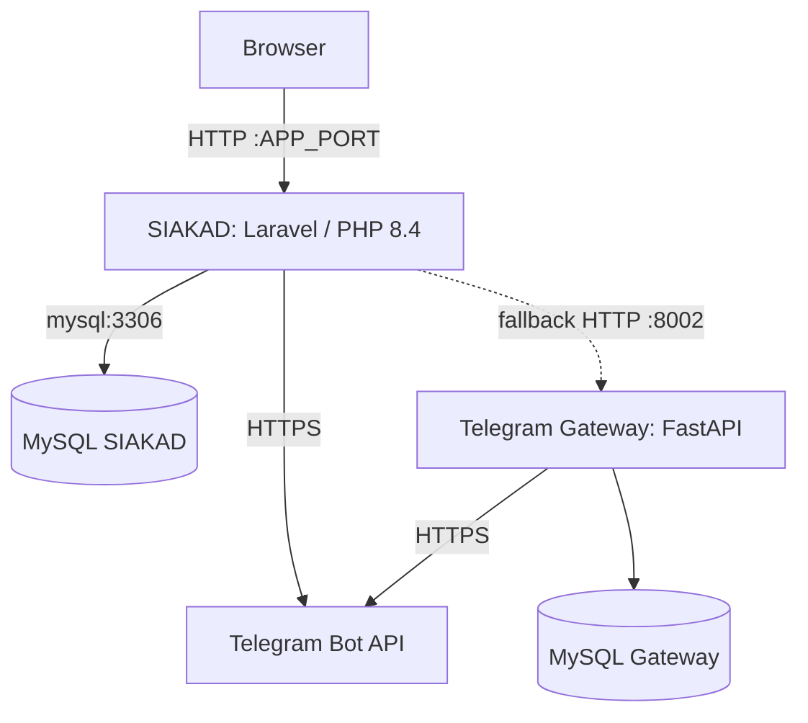

# ☁️ Tugas Besar Cloud Computing

## Anggota Kelompok
1. **M. Syihabul Alam** (240602008)
2. **M. Nur Amin** (260602001)
3. **Dimas Candra** (240602001)
4. **M. Askhabur Rida'** (240602007)

---

## Mengapa aplikasi lebih cepat dijalankan dari WSL?

Saat proyek dijalankan dari `D:\...` di Windows, Docker memasang seluruh folder proyek ke container melalui *bind mount*. Laravel/PHP membaca banyak file aplikasi dan dependensi pada setiap permintaan. Akses file lintas filesystem Windows–Linux ini menambah latensi; halaman sederhana seperti `/health` pun sempat lambat, sementara aset statis merespons cepat.

Setelah proyek dipindahkan ke filesystem Linux WSL (`/home/<user>/...`), aplikasi terasa cepat. Ini menunjukkan bahwa akses file dari mount Windows adalah penyebab utama yang paling mungkin—bukan pengiriman Telegram. Menaruh proyek di filesystem WSL mengurangi overhead baca file. Tetap gunakan Docker Desktop yang terintegrasi dengan distro WSL, dan jangan menyimpan atau menjalankan salinan cepat dari `/mnt/c` atau `/mnt/d`.

## Pilih cara memulai

- **Sudah pernah menjalankan proyek di Windows dan ingin mempertahankan database:** ikuti [Migrasi proyek yang sudah berjalan ke WSL](#migrasi-proyek-yang-sudah-berjalan-ke-wsl).
- **Baru mulai atau clone baru:** ikuti [Menjalankan dari awal](#menjalankan-dari-awal).
Pilih satu alur sesuai kondisi proyek; keduanya berisi langkah konfigurasi dan menjalankan layanan.

---

## Prasyarat

- Docker Desktop dengan backend WSL 2 aktif.
- Distro Ubuntu WSL 2, misalnya Ubuntu-24.04.
- Integrasi distro diaktifkan melalui **Docker Desktop → Settings → Resources → WSL Integration**.
- Koneksi internet untuk mengunduh image dan dependensi.
- Token Telegram dari BotFather jika ingin mengirim notifikasi.

Buka terminal Ubuntu WSL dan pastikan Docker tersedia:

```bash
docker version
docker compose version
```

Jalankan proyek di bawah `$HOME` (contoh: `/home/nama-user/projects`), bukan di `/mnt/c` atau `/mnt/d`.

## Arsitektur dan port



| Layanan | Port host default | Keterangan |
|---|---:|---|
| SIAKAD | `8080` | URL dari `APP_URL`, misalnya `http://localhost:8080` |
| MySQL SIAKAD | `3306` | Port container tetap `3306`; port host dapat diubah dengan `FORWARD_DB_PORT` |
| Mailpit | `8025` | Dashboard email lokal |
| Telegram Gateway | `8002` | API dan dokumentasi di `http://localhost:8002/docs` |
| MySQL Gateway | `3307` | Database milik Gateway |
| Nginx Gateway | `80` | Reverse proxy Gateway |

Jika port host bentrok, ubah port host terkait di `.env` tanpa mengubah `DB_HOST=mysql` atau port database internal container.

---

## Migrasi proyek yang sudah berjalan ke WSL

Langkah ini ditujukan untuk pengguna yang sebelumnya menjalankan SIAKAD dari folder Windows dan ingin mempertahankan database Docker yang sudah ada. Docker Desktop mengelola volume di luar folder proyek, sehingga volume dapat digunakan kembali selama memakai Docker daemon dan nama proyek Compose yang sama.

### 1. Hentikan SIAKAD lama dengan aman

Di PowerShell Windows, masuk ke folder SIAKAD lama lalu hentikan containernya:

```powershell
Set-Location "D:\Dimas\Kuliah\Semester 5\Cloud Computing\Tugas_CloudComputing\siakad(service1)"
docker compose down
```

`docker compose down` tidak menghapus volume database. **Jangan gunakan `docker compose down -v`** jika ingin mempertahankan data. Gateway Telegram yang berjalan dari folder proyek terpisah tidak perlu dihentikan.

### 2. Salin proyek ke filesystem Ubuntu

Di terminal Ubuntu WSL:

```bash
sudo apt update
sudo apt install -y rsync

mkdir -p "$HOME/projects/Tugas_CloudComputing/siakad(service1)"
rsync -av \
  --exclude '.git' \
  --exclude 'vendor' \
  --exclude 'node_modules' \
  --exclude 'storage/logs/*' \
  '/mnt/d/Dimas/Kuliah/Semester 5/Cloud Computing/Tugas_CloudComputing/siakad(service1)/' \
  "$HOME/projects/Tugas_CloudComputing/siakad(service1)/"
```

Path sumber di atas sesuai lokasi proyek pada komputer pengembang. Jika proyek Anda berada di folder atau drive lain, ubah path `/mnt/d/...` agar menunjuk ke folder `siakad(service1)` milik Anda.

`rsync` menyalin `.env` juga. Pastikan file konfigurasi itu ada:

```bash
cd "$HOME/projects/Tugas_CloudComputing/siakad(service1)"
test -f .env && echo ".env ditemukan"
```

Jika `.env` tidak ikut tersalin, salin dari lokasi lama secara langsung tanpa membuka atau menempelkan isinya ke chat:

```bash
cp '/mnt/d/Dimas/Kuliah/Semester 5/Cloud Computing/Tugas_CloudComputing/siakad(service1)/.env' .env
```

### 3. Pastikan volume database lama tersedia

```bash
docker volume ls
docker volume inspect siakadservice1_sail-mysql \
  --format '{{ index .Labels "com.docker.compose.project" }} / {{ index .Labels "com.docker.compose.volume" }}'
```

Untuk konfigurasi proyek ini, volume yang digunakan sebelumnya bernama `siakadservice1_sail-mysql`. Label yang diharapkan adalah `siakadservice1 / sail-mysql`. Jika volume tidak ditemukan atau label berbeda, **berhenti sebelum menjalankan `up`** dan periksa nama project/volume Compose lama. Jangan membuat database baru atau menghapus volume lama sebelum memastikan lokasi datanya.

Setelah dipastikan cocok, gunakan `-p siakadservice1` pada perintah Compose berikutnya. Opsi ini memastikan Compose memasang volume lama dengan nama yang sama.

### 4. Pasang dependensi PHP

Folder `vendor` tidak disalin karena dependensi dapat dibuat kembali:

```bash
docker run --rm \
  -u "$(id -u):$(id -g)" \
  -v "$PWD:/var/www/html" \
  -w /var/www/html \
  laravelsail/php84-composer:latest \
  composer install --no-interaction
```

### 5. Jalankan SIAKAD dengan volume yang sama

```bash
docker compose -p siakadservice1 up -d --build mysql laravel.test
docker compose -p siakadservice1 up -d laravel.queue
docker compose -p siakadservice1 ps
```

Jangan menjalankan `key:generate` atau `migrate --seed` lagi pada database yang berisi data. Perintah tersebut ditujukan untuk instalasi baru; lihat bagian [Database: baru atau sudah berisi data?](#database-baru-atau-sudah-berisi-data).

---

## Menjalankan dari awal

### 1. Clone repo ke filesystem WSL

Di terminal Ubuntu WSL:

```bash
mkdir -p "$HOME/projects"
cd "$HOME/projects"
git clone <URL_REPOSITORY_GITHUB_ANDA> Tugas_CloudComputing
cd "$HOME/projects/Tugas_CloudComputing"
```

Jangan clone ke `/mnt/c` atau `/mnt/d` jika ingin menghindari overhead akses file lintas filesystem.

### 2. Buat file konfigurasi lokal

```bash
cp "siakad(service1)/.env.example" "siakad(service1)/.env"
cp "telegramgateway(service2)/.env.example" "telegramgateway(service2)/.env"
```

File `.env` berisi konfigurasi lokal dan rahasia; jangan commit atau membagikan isinya. Edit dengan `nano`, misalnya:

```bash
nano "siakad(service1)/.env"
nano "telegramgateway(service2)/.env"
```

Konfigurasi dasar SIAKAD pada `.env`:

- `APP_URL=http://localhost:8080` dan `APP_PORT=8080` (ubah jika port sedang dipakai).
- `DB_HOST=mysql`, `DB_PORT=3306`, `DB_DATABASE=siakad`, `DB_USERNAME=sail`, dan `DB_PASSWORD` sesuai konfigurasi. `DB_HOST` harus tetap `mysql` untuk koneksi antarkontainer.
- Jika port MySQL host `3306` bentrok, atur `FORWARD_DB_PORT=3308`; ini tidak mengubah `DB_PORT` di dalam jaringan Docker.
- Isi `TELEGRAM_BOT_TOKEN` dan `TELEGRAM_NOTIFICATION_CHAT_ID` jika ingin mengirim notifikasi langsung ke grup.
- `TELEGRAM_GATEWAY_URL=http://host.docker.internal:8002` dipakai sebagai fallback jika pengiriman langsung tidak dikonfigurasi.

Token SIAKAD dan Gateway harus berasal dari bot yang sama jika Gateway dipakai. Jangan menaruh token atau Chat ID grup di README, `.env.example`, source code, atau commit. Jika token pernah terpublikasi, cabut dan buat token baru melalui BotFather.

### 3. (Opsional) Jalankan Telegram Gateway

Jika SIAKAD sudah memiliki `TELEGRAM_BOT_TOKEN`, pengiriman notifikasi dapat dilakukan langsung ke Telegram Bot API; Gateway bukan syarat untuk jalur utama. Jalankan Gateway jika ingin menyediakan jalur fallback:

```bash
cd "$HOME/projects/Tugas_CloudComputing/telegramgateway(service2)"
docker compose up -d --build
```

Dokumentasi Gateway tersedia di [http://localhost:8002/docs](http://localhost:8002/docs).

### 4. Pasang dependensi SIAKAD

```bash
cd "$HOME/projects/Tugas_CloudComputing/siakad(service1)"
docker run --rm \
  -u "$(id -u):$(id -g)" \
  -v "$PWD:/var/www/html" \
  -w /var/www/html \
  laravelsail/php84-composer:latest \
  composer install --no-interaction
```

### 5. Jalankan aplikasi dan inisialisasi database baru

```bash
docker compose -p siakadservice1 up -d --build mysql laravel.test
docker compose -p siakadservice1 exec laravel.test php artisan key:generate
docker compose -p siakadservice1 exec laravel.test php artisan migrate --seed
docker compose -p siakadservice1 up -d laravel.queue
```

Perintah `migrate --seed` membuat tabel dan mengisi data demo. Akun demo setelah seeding:

| Peran | Email | Kata sandi |
|---|---|---|
| Superadmin | `superadmin@siakad.test` | `password` |
| Admin Fakultas | `admin.ftik@siakad.test` | `password` |
| Dosen | `dosen@siakad.test` | `password` |
| Mahasiswa | `mahasiswa@siakad.test` | `password` |

Ganti kredensial demo jika aplikasi akan digunakan di luar lingkungan lokal/pengujian.

---

## Database: baru atau sudah berisi data?

- **Database instalasi baru:** jalankan `php artisan key:generate` satu kali, lalu `php artisan migrate --seed`.
- **Database yang sudah berisi data:** jangan menjalankan `key:generate` karena dapat membuat data terenkripsi lama tidak dapat dibaca. Jangan menjalankan `migrate --seed` karena seeder dapat menambah atau mengubah data demo. Pertahankan volume dan `.env` yang sama. Jika ada migrasi aplikasi yang memang belum diterapkan, buat cadangan database terlebih dahulu lalu jalankan `php artisan migrate --force` setelah meninjau perubahan.
- `docker compose down` menghentikan/menghapus container dan network proyek, tetapi mempertahankan volume. `docker compose down -v` juga menghapus volume dan dapat menghapus database.

Jalankan perintah `php artisan` melalui container agar konfigurasi `DB_HOST=mysql` dapat di-resolve:

```bash
docker compose -p siakadservice1 exec laravel.test php artisan <perintah>
```

Jangan jalankan `php artisan` langsung di PowerShell/Ubuntu host untuk aplikasi Docker ini, dan jangan mengganti `DB_HOST=mysql` menjadi `localhost`.

---

## Menguji notifikasi Telegram

1. Buka bot Telegram dan tekan **Start**.
2. Tambahkan bot ke grup privat yang anggotanya berwenang melihat notifikasi akademik dan informasi login.
3. Atur `TELEGRAM_BOT_TOKEN` dan `TELEGRAM_NOTIFICATION_CHAT_ID` pada `.env` SIAKAD. Chat ID grup dan token adalah rahasia; jangan tempelkan nilainya ke chat atau commit.
4. Jika menggunakan Gateway sebagai fallback, pastikan Gateway berjalan dan variabel token Gateway telah diatur. Token SIAKAD yang valid membuat SIAKAD mengirim langsung ke Bot API.
5. Setelah mengubah `.env`, mulai ulang aplikasi dan worker:

   ```bash
   docker compose -p siakadservice1 restart laravel.test laravel.queue
   ```

6. Uji alur berikut dan pastikan worker tetap hidup:
   - **Login:** logout, lalu login kembali; grup seharusnya menerima notifikasi login.
   - **KRS:** ajukan KRS sebagai mahasiswa, lalu minta dosen PA/admin menyetujui atau menolak pengajuan.
   - **Perubahan jadwal:** sebagai admin, ubah hari, jam, atau ruangan kelas yang memiliki mahasiswa terdaftar.
   - **Nilai:** sebagai dosen, simpan atau perbarui nilai mahasiswa.

Periksa status dan log jika notifikasi tidak tiba:

```bash
docker compose -p siakadservice1 ps
docker compose -p siakadservice1 logs --tail=100 laravel.test laravel.queue
docker compose -p siakadservice1 exec laravel.test php artisan queue:failed
```

Jika memakai Gateway sebagai fallback, periksa juga:

```bash
cd "$HOME/projects/Tugas_CloudComputing/telegramgateway(service2)"
docker compose ps
docker compose logs --tail=100
```

Notifikasi dikirim secara asinkron. Waktu tiba masih dipengaruhi polling worker, koneksi internet, dan respons Telegram; pengiriman tanpa jeda tidak dijamin.

Tes otomatis dispatch yang tidak mengirim pesan nyata:

```bash
docker compose -p siakadservice1 exec laravel.test \
  php artisan test tests/Unit/TelegramNotificationDispatchTest.php
```

Jangan menjalankan `php artisan queue:work` langsung di host. Gunakan worker container `laravel.queue`; aplikasi memakai `DB_HOST=mysql`, nama host yang hanya tersedia di jaringan Docker.

Untuk menjalankan worker di foreground sementara debugging, hentikan worker latar dahulu agar tidak ada dua worker yang memproses antrean:

```bash
docker compose -p siakadservice1 stop laravel.queue
docker compose -p siakadservice1 exec laravel.test \
  php artisan queue:work database --verbose
```

Setelah menghentikan worker foreground dengan `Ctrl+C`, hidupkan kembali:

```bash
docker compose -p siakadservice1 start laravel.queue
```

---

## Verifikasi performa dan perintah harian

Aplikasi tersedia di `APP_URL` (default: [http://localhost:8080](http://localhost:8080)). Jika `APP_PORT` diubah, akses port tersebut. Ukur respons login dari Ubuntu:

```bash
curl -sS -o /dev/null \
  -w 'HTTP=%{http_code} TTFB=%{time_starttransfer} Total=%{time_total}\n' \
  "http://localhost:8080/login"
```

Jika port berbeda, ganti `8080` dengan nilai `APP_PORT` dari `.env`.

Status dan log:

```bash
docker compose -p siakadservice1 ps
docker compose -p siakadservice1 logs -f laravel.test
docker compose -p siakadservice1 logs -f laravel.queue
```

Hentikan layanan tanpa menghapus database:

```bash
docker compose -p siakadservice1 down
```

Untuk menjalankan kembali:

```bash
docker compose -p siakadservice1 up -d
```

Untuk melihat container dan log Gateway:

```bash
docker ps
cd "$HOME/projects/Tugas_CloudComputing/telegramgateway(service2)"
docker compose ps
docker compose logs -f
```

### Pemeliharaan

| Kebutuhan | Perintah |
|---|---|
| Bersihkan cache tampilan Blade | `docker compose -p siakadservice1 exec laravel.test php artisan view:clear` |
| Periksa antrean gagal | `docker compose -p siakadservice1 exec laravel.test php artisan queue:failed` |
| Restart SIAKAD dan worker setelah mengubah `.env` | `docker compose -p siakadservice1 restart laravel.test laravel.queue` |
| Hentikan SIAKAD tanpa menghapus database | `docker compose -p siakadservice1 down` |
| Hentikan Gateway | Dari folder `telegramgateway(service2)`, jalankan `docker compose down` |

Jika perlu GUI untuk database SIAKAD dan port `8082` kosong, jalankan phpMyAdmin secara opsional:

```bash
docker run -d --name siakad-pma --network siakadservice1_sail \
  -p 8082:80 -e PMA_HOST=mysql phpmyadmin/phpmyadmin
```

Akses di [http://localhost:8082](http://localhost:8082). Login menggunakan kredensial database pada `.env` SIAKAD. Hapus container GUI setelah selesai jika tidak diperlukan:

```bash
docker rm -f siakad-pma
```

Jangan menghapus `.env`, volume database, atau log tanpa memahami dampaknya. Jangan gunakan `docker compose down -v` jika data database masih diperlukan. Untuk akun demo, lihat tabel pada bagian [Menjalankan dari awal](#menjalankan-dari-awal).
